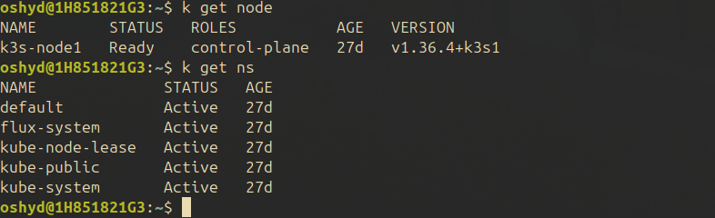
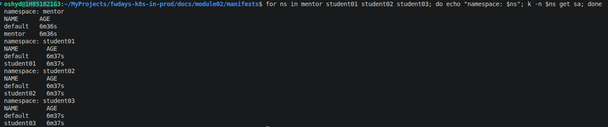
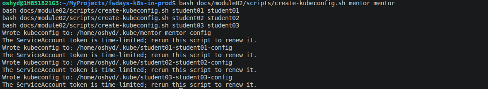
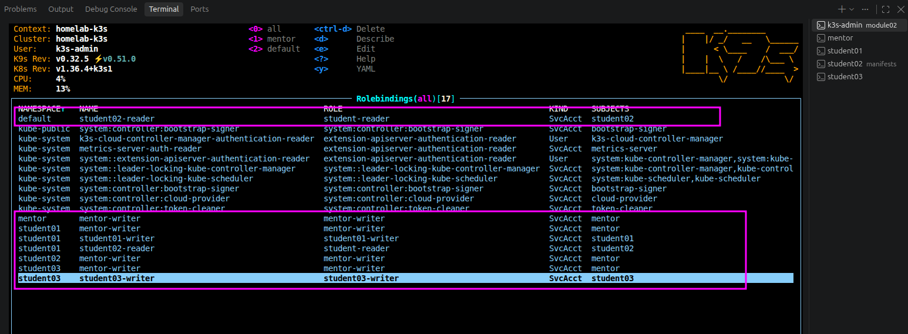

# Task description

## Module 02 – Security & Policy as Code

1.Створити Kubernetes кластер з неймспейсом для ментора і 3 неймспейсами для студентів (e.g. student01, student02, student03)

Ментор і кожний студент мають мати окремі kubeconfig файли.

Впровадити RBAC:

- Ментор повинен мати RW доступ до неймспейсів студентів

- 01 і 03 студенти мають RW доступи тільки до своїх неймспейсів

- Студент 02 має RO доступ до неймспейсу студента 01 і неймспейсу default

- Ані ментор, ані студенти не повинні мати права Cluster Admin

2. Створити Kyverno policy для валідації readonly root filesystem в режимі аудиту.

3. Створити Kyverno policy для додавання label "person" в поди. В студентських неймспейсах цей label має мати значення "student", у ментора відповідно "mentor", всі інші неймспейси не мають мати цього лейбла взагалі.

---

# Realisation

I'll be using existing k3s cluster with one control-plane node



## Steps

### Create namespaces and service accounts

Manifests: [01-service-accounts.yaml](./manifests/01-service-accounts.yaml)

Apply command:

```
k apply -f manifests/01-service-accounts.yaml
```

Result:



### Create a kubeconfig for a ServiceAccounts

The script uses the active `kubectl` context to obtain the cluster endpoint and
CA, requests a time-limited token for the specified ServiceAccount, and writes a
standalone kubeconfig with owner-only permissions. Specify the ServiceAccount
name and its namespace; both are required because ServiceAccounts are
namespace-scoped. Run it after applying the namespace, ServiceAccount, and RBAC
manifests:

```
bash docs/module02/scripts/create-kubeconfig.sh mentor mentor
```

By default, the kubeconfig is stored at
`~/.kube/<namespace>-<service-account>-config`. For example, to create a
kubeconfig for the `student01` ServiceAccount, or to choose a different output
path, run:

```
bash docs/module02/scripts/create-kubeconfig.sh student01 student01
bash docs/module02/scripts/create-kubeconfig.sh mentor mentor ./mentor.kubeconfig
```

The token expires after the duration allowed by the cluster (typically one
hour). Rerun the script to obtain a fresh token. Do not commit the generated
kubeconfig; it grants access as the mentor ServiceAccount.

#### Execution:

```
bash docs/module02/scripts/create-kubeconfig.sh mentor mentor
bash docs/module02/scripts/create-kubeconfig.sh student01 student01
bash docs/module02/scripts/create-kubeconfig.sh student02 student02
bash docs/module02/scripts/create-kubeconfig.sh student03 student03
```

Result:



### RBAC manifests

The RBAC is split into role definitions (`02-*`) and namespace-scoped
RoleBindings (`03-*`). A `ClusterRole` defines reusable permissions but does
not grant access on its own; the RoleBindings grant those permissions only in
the namespaces named in each binding. No `ClusterRoleBinding` is used, so these
manifests do not grant cluster-wide access.

| Manifest                                                     | Contents                                                                                                                                                                                       |
| ------------------------------------------------------------ | ---------------------------------------------------------------------------------------------------------------------------------------------------------------------------------------------- |
| [02-cluster-roles.yaml](./manifests/02-cluster-roles.yaml)   | Defines `mentor-writer` and `student-reader` ClusterRoles, configured with read/write and read-only verbs respectively for the resource names listed under the core API group in the manifest. |
| [03-student01-rbac.yaml](./manifests/03-student01-rbac.yaml) | Defines and binds a writer Role for the `student01` ServiceAccount, scoped to `student01`.                                                                                                     |
| [03-student02-rbac.yaml](./manifests/03-student02-rbac.yaml) | Binds `student-reader` to the `student02` ServiceAccount in `student01` and `default`, granting read-only access in those namespaces.                                                          |
| [03-student03-rbac.yaml](./manifests/03-student03-rbac.yaml) | Defines and binds a writer Role for the `student03` ServiceAccount, scoped to `student03`.                                                                                                     |

Apply the role definitions and bindings after creating the namespaces and
ServiceAccounts:

```
k apply -f manifests/02-cluster-roles.yaml
k apply -f manifests/03-mentor-rbac.yaml
k apply -f manifests/03-student01-rbac.yaml
k apply -f manifests/03-student02-rbac.yaml
k apply -f manifests/03-student03-rbac.yaml
```

Result:



### Install Kyverno and apply the read-only root filesystem policy

Kyverno must be installed in the cluster before its policies can be applied.
The following commands use Helm; install Helm first if it is not already
available. Run them with a kubeconfig that has permission to install
cluster-wide components:

```
helm repo add kyverno https://kyverno.github.io/kyverno/
helm repo update
helm upgrade --install kyverno kyverno/kyverno \
  --namespace kyverno \
  --create-namespace \
  --wait
```

Check that Kyverno's deployments are available and its policy custom resource
definitions are registered:

```
k -n kyverno get deployments
k get crds | grep kyverno.io
```

The [04-kyverno-require-readonly-rootfs.yaml](./manifests/04-kyverno-require-readonly-rootfs.yaml)
manifest defines a cluster-wide `ClusterPolicy`. It checks regular and init
containers in Pods for `securityContext.readOnlyRootFilesystem: true`.
`validationFailureAction: Audit` reports non-compliant Pods without blocking
their creation, and `background: true` enables checks of existing resources.

Apply the policy from the `docs/module02` directory:

```
k apply -f manifests/04-kyverno-require-readonly-rootfs.yaml
k get clusterpolicy require-readonly-rootfs
k get policyreport -A
```

Policy reports are populated for workloads Kyverno evaluates; an empty report
list does not necessarily mean the policy was not installed. The ClusterPolicy
status and Kyverno controller logs can also help diagnose policy readiness or
evaluation problems.
