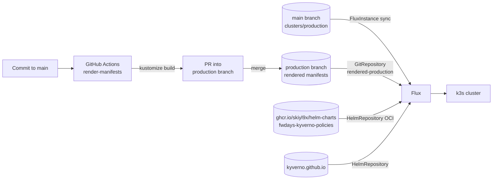
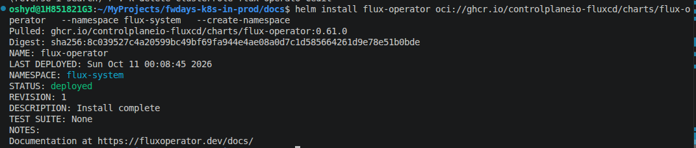
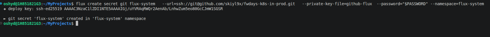

# Task description

## Module 03 – Platform Engineering

1. Налаштувати GitOps систему (ArgoCD, Flux etc.) для майбутніх змін.

2. Переписати полісі з ДЗ Module02 на використання Helm чартів


---

# Realisation

The cluster is the same single-node k3s cluster as in [Module 02](../module02/README.md).
GitOps is implemented with **Flux**, installed and managed by the
[Flux Operator](https://fluxoperator.dev/). The Kyverno policies from Module 02
are packaged as a Helm chart, published to GitHub Container Registry, and
deployed by Flux as a `HelmRelease`.

## Architecture



- **`main`** holds the sources: Flux configuration in `clusters/production/`, and
  Kustomize bases and overlays in `infrastructure/`.
- **`production`** holds the rendered manifests. A GitHub Actions workflow builds
  the overlays from `main` and opens a PR into `production`, so every change to
  the cluster is reviewed as plain YAML before Flux applies it.
- **Flux** syncs `clusters/production/` from `main` and applies the rendered
  manifests from `production`.

### Repository layout

```
clusters/production/
├── flux-instance.yaml        # FluxInstance: Flux components + sync of this folder from main
├── gitrepos.yaml             # GitRepository "rendered-production" -> production branch
├── helmrepos.yaml            # OCI HelmRepository for ghcr.io/skiyl9x/helm-charts
├── infrastructure.yaml       # Flux Kustomizations: infra-controllers -> infra-configs
├── policies.yaml             # Flux Kustomization: policies (dependsOn infra-controllers)
└── flux-web-ui.yaml          # Flux Web UI
infrastructure/               # operators and their CRDs
├── base/controllers/kyverno/        # Namespace, HelmRepository, HelmRelease (Kyverno 3.9.1)
└── production/controllers/kyverno/  # production overlay
policies/                     # cluster-wide guardrails
├── base/kyverno-policies/           # HelmRelease of fwdays-kyverno-policies
└── production/kyverno-policies/     # production overlay
.github/workflows/render-manifests.yaml   # renders */production overlays -> production branch
scripts/validate.sh                       # local validation of manifests and overlays
```

## 1. Set up GitOps with Flux

### Install the Flux Operator

```
helm install flux-operator oci://ghcr.io/controlplaneio-fluxcd/charts/flux-operator \
  --namespace flux-system \
  --create-namespace
```



### Create the Git SSH secret

Flux reads this repository over SSH. Generate a key pair:

```
ssh-keygen -t ed25519 -C "flux@github.com" -f github-flux
```

Create the `flux-system` secret from the private key. `--password` is the key
passphrase chosen in `ssh-keygen`:

```
flux create secret git flux-system \
  --url=ssh://git@github.com/skiyl9x/fwdays-k8s-in-prod.git \
  --private-key-file=github-flux \
  --password="$PASSWORD" \
  --namespace=flux-system
```

The command prints the public key. Add it to the repository in
**GitHub → Settings → Deploy keys** (read-only access is enough).



Do not commit the private key (`github-flux`).

### Create the Flux instance

[`clusters/production/flux-instance.yaml`](../../clusters/production/flux-instance.yaml)
defines a `FluxInstance`. The Flux Operator installs Flux `2.7.x` with the
source, kustomize, helm, notification and image automation controllers, and
creates a `GitRepository` and `Kustomization` that sync `clusters/production`
from the `main` branch, using the `flux-system` secret created above.

```
kubectl apply -f clusters/production/flux-instance.yaml
```

From now on, every file added to `clusters/production/` on `main` is applied by
Flux automatically; there is no need to run `kubectl apply` again.

### Sources

| File | Object | Points to |
|---|---|---|
| [`gitrepos.yaml`](../../clusters/production/gitrepos.yaml) | `GitRepository` `rendered-production` | `production` branch of this repository (HTTPS) |
| [`helmrepos.yaml`](../../clusters/production/helmrepos.yaml) | `HelmRepository` `skiyl9x-helm-charts` (type `oci`) | `oci://ghcr.io/skiyl9x/helm-charts` |
| [`infrastructure/base/controllers/kyverno/helmrepo.yaml`](../../infrastructure/base/controllers/kyverno/helmrepo.yaml) | `HelmRepository` `kyverno` | `https://kyverno.github.io/kyverno` |

The chart registry on GHCR is private, so Flux needs credentials to pull from it.
Create a GitHub personal access token with the `read:packages` scope and store it
as a registry secret (referenced by `secretRef` in `helmrepos.yaml`):

```
kubectl create secret docker-registry github-oci-auth \
  --namespace=flux-system \
  --docker-server=ghcr.io \
  --docker-username=skiyl9x \
  --docker-password=<github-token>
```

### Layers

Each top-level folder is a separate layer with its own Flux `Kustomization`,
all reading from the `rendered-production` source:

| Kustomization | Defined in | Path | Contents |
|---|---|---|---|
| `infra-controllers` | [`infrastructure.yaml`](../../clusters/production/infrastructure.yaml) | `./infrastructure/controllers` | Operators and their CRDs: Kyverno. `wait: true` makes Flux wait until they are ready. |
| `infra-configs` | [`infrastructure.yaml`](../../clusters/production/infrastructure.yaml) | `./infrastructure/configs` | Configuration for the operators, e.g. issuers or cluster-wide settings (currently empty). `dependsOn: infra-controllers`. |
| `policies` | [`policies.yaml`](../../clusters/production/policies.yaml) | `./policies` | Kyverno policies. `dependsOn: infra-controllers` guarantees the Kyverno CRDs exist first. |

### Rendered manifests workflow

[`.github/workflows/render-manifests.yaml`](../../.github/workflows/render-manifests.yaml)
runs on every push to `main` that touches `apps/**`, `infrastructure/**` or `policies/**`:

1. Runs `kustomize build` for every directory in
   `infrastructure/production/controllers/`, `infrastructure/production/configs/`
   and `policies/production/`.
2. Writes the result to `infrastructure/controllers/<name>.yaml`,
   `infrastructure/configs/<name>.yaml` and `policies/<name>.yaml`, replacing the
   previously rendered files (so files removed from `main` are removed from
   `production` as well).
3. Opens a PR into the `production` branch (and closes the previous open one if it
   is outdated).

Merging that PR is the moment the change reaches the cluster.

### Validation

[`scripts/validate.sh`](../../scripts/validate.sh), taken from
[fluxcd/flux2-kustomize-helm-example](https://github.com/fluxcd/flux2-kustomize-helm-example),
downloads the Flux OpenAPI schemas and validates all YAML files and Kustomize
overlays with `kubeconform`. Run it before pushing to `main`
(requires `yq`, `kustomize` and `kubeconform`):

```
bash scripts/validate.sh
```

### Check the state

```
flux get sources all -A
flux get kustomizations -A
flux get helmreleases -A
```

## 2. Kyverno policies as a Helm chart

### Install Kyverno

Kyverno is installed by Flux from
[`infrastructure/base/controllers/kyverno`](../../infrastructure/base/controllers/kyverno):
a `Namespace`, the `kyverno` `HelmRepository`, and a `HelmRelease` pinned to chart
version `3.9.1` (Kyverno v1.19.1). `crds: CreateReplace` lets Flux install and
upgrade Kyverno's CRDs. This replaces the manual `helm upgrade --install kyverno`
from Module 02.

### The chart

The policies from Module 02
([`04-kyverno-require-readonly-rootfs.yaml`](../module02/manifests/04-kyverno-require-readonly-rootfs.yaml),
[`05-kyverno-person-label.yaml`](../module02/manifests/05-kyverno-person-label.yaml))
are packaged as the
[`fwdays-kyverno-policies`](https://github.com/skiyl9x/helm-charts/tree/main/charts/fwdays-kyverno-policies)
chart in the [skiyl9x/helm-charts](https://github.com/skiyl9x/helm-charts)
repository and published to `oci://ghcr.io/skiyl9x/helm-charts`.

The chart renders three `ClusterPolicy` objects:

| Policy | Purpose | Values |
|---|---|---|
| `require-readonly-rootfs` | Containers and init containers must set `readOnlyRootFilesystem: true` | `policies.requireReadonlyRootfs.{enabled,failureAction,background}` |
| `add-person-label` | Adds `person=mentor` / `person=student` to Pods in the listed namespaces | `policies.addPersonLabel.enabled`, `personLabel.persons` |
| `forbid-person-label-outside-owner-namespaces` | Rejects Pods with the `person` label in any other namespace | `policies.forbidPersonLabel.{enabled,failureAction,background}` |

The namespaces are no longer hard-coded: the mutation rules and the exclusion
list of the forbid policy are both generated from `personLabel.persons`, so the
two policies cannot get out of sync. With default values the chart renders the
same policies as the Module 02 manifests.

### Deploy with Flux

[`policies/base/kyverno-policies/helmrelease.yaml`](../../policies/base/kyverno-policies/helmrelease.yaml)
installs chart version `0.1.0` from the `skiyl9x-helm-charts` source:

```yaml
spec:
  chart:
    spec:
      chart: fwdays-kyverno-policies
      version: 0.1.0
      sourceRef:
        kind: HelmRepository
        name: skiyl9x-helm-charts
        namespace: flux-system
  values:
    personLabel:
      key: person
      persons:
        mentor:
          namespaces: [mentor]
        student:
          namespaces: [student01, student02, student03]
```

To add a new student namespace, add it to `personLabel.persons.student.namespaces`
in this file and merge the generated PR into `production`.

Check the result:

```
flux get helmreleases -n kyverno
kubectl get clusterpolicy
```
