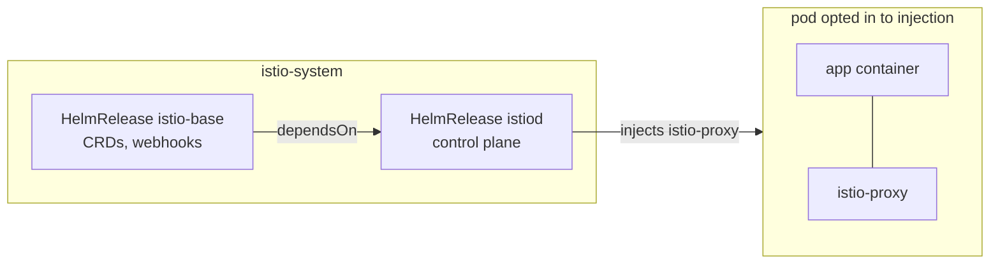

# Task description

## Module 04 – Service Mesh

1. Встановити Istio service mesh в режимі sidecar.

---

# Realisation

Istio is installed on the same single-node k3s cluster as in
[Module 03](../module03/README.md), through the same GitOps flow: Kustomize
bases and overlays on `main`, rendered into the `production` branch by GitHub
Actions, applied by Flux. Nothing is installed with `istioctl` or `helm install`
by hand.

Sidecar mode means every pod in the mesh gets an extra `istio-proxy` (Envoy)
container. `istiod` adds it through a mutating admission webhook when the pod is
created, and the `istio-init` init container redirects the pod's traffic through
the proxy with iptables rules.

## Architecture



### Repository layout (new files)

```
infrastructure/
├── base/controllers/istio/            # Namespace, HelmRepository, HelmReleases istio-base and istiod
└── production/controllers/istio/      # production overlay  -> infra-controllers layer
```

No changes are needed in `clusters/production/` or in the render workflow: it
already renders every directory in `infrastructure/production/controllers/`.

## 1. Install Istio

[`infrastructure/base/controllers/istio`](../../infrastructure/base/controllers/istio)
uses the official Helm charts from `https://istio-release.storage.googleapis.com/charts`,
pinned to Istio `1.30.6`:

| HelmRelease | Chart | What it installs |
|---|---|---|
| [`istio-base`](../../infrastructure/base/controllers/istio/helmrelease-base.yaml) | `base` | Istio CRDs (`crds: CreateReplace` lets Flux install and upgrade them) and cluster-wide resources. |
| [`istiod`](../../infrastructure/base/controllers/istio/helmrelease-istiod.yaml) | `istiod` | The control plane and the sidecar injection webhook. `dependsOn: istio-base`, so it starts only after the CRDs exist. |

Values set for `istiod`:

- `pilot.autoscaleEnabled: false`, `pilot.replicaCount: 1`: one replica and no HPA on a single-node cluster.
- `global.proxy.resources`: small requests for each sidecar (10m CPU, 64Mi memory), so the sidecars don't take up the node.
- `meshConfig.accessLogFile: /dev/stdout`: Envoy access logs, seen with `kubectl logs <pod> -c istio-proxy`.

Both releases are part of the `infra-controllers` layer, which has `wait: true`,
so Flux treats the layer as ready only when `istiod` is running.

No ingress gateway is installed: the task asks only for the sidecar data plane.
A gateway can be added later as one more `HelmRelease` of the `gateway` chart.

No `PeerAuthentication` is created, so the mesh uses Istio's default `PERMISSIVE`
mode: pods with a sidecar accept both mTLS and plain-text traffic, and clients
outside the mesh (for example the k3s Traefik ingress) can still reach them.

## 2. Enable sidecar injection

No namespace is added to the mesh by this change; the tenant namespaces
(`mentor`, `student01..03`) are not modified. Injection is opt-in, in one of two ways:

- for a whole namespace: label it, and new pods in it get a sidecar

  ```
  kubectl label namespace <namespace> istio-injection=enabled
  ```

- for a single workload: add the label `sidecar.istio.io/inject: "true"` to the pod template

Injection happens only when a pod is created. Pods that were running before the
namespace was labelled have no sidecar until they are restarted:

```
kubectl -n <namespace> rollout restart deployment
```

## 3. Kyverno compatibility

The `require-readonly-rootfs` policy from Module 03 checks every container and
init container, including the injected ones. Kyverno validates the pod after
Istio's mutating webhook has added them:

- `istio-proxy` runs with `readOnlyRootFilesystem: true` and passes.
- `istio-init` runs as root with `readOnlyRootFilesystem: false` and the `NET_ADMIN`
  and `NET_RAW` capabilities, because it writes iptables rules. It fails the policy.

The policy is in `Audit` mode, so injected pods still start and the violation
shows up only in the policy reports (`kubectl get policyreport -A`). Before
switching the policy to `Enforce`, do one of the following:

- Install the Istio CNI node agent (`cni` chart, with `global.platform: k3s` for the
  k3s CNI paths) and set `pilot.cni.enabled: true` in `istiod`. That replaces
  `istio-init` with an `istio-validation` init container, which runs as non-root
  with a read-only root filesystem.
- Or exclude the `istio-init` container from the policy.

## Check the state

```
flux get helmreleases -n istio-system
kubectl -n istio-system get pods
kubectl get mutatingwebhookconfigurations
```

Test the injection with a single pod that opts in. The pod should show `2/2` containers:

```
kubectl run httpbin --image=docker.io/kong/httpbin --port=80 --labels=sidecar.istio.io/inject=true
kubectl get pod httpbin
kubectl get pod httpbin -o jsonpath='{.spec.containers[*].name}'
kubectl delete pod httpbin
```

With `istioctl` on the workstation, check that the sidecar is connected to `istiod`:

```
istioctl proxy-status
```
