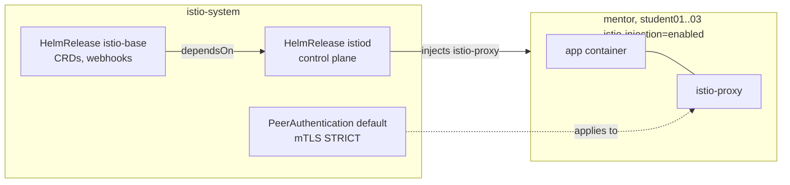

# Task description

## Module 04 – Service Mesh

1. Встановити Istio service mesh в режимі sidecar.

---

# Realisation

Istio is installed on the same single-node k3s cluster as in
[Module 03](../module03/README.md), through the same GitOps flow: Kustomize
bases and overlays on `main`, rendered into the `production` branch by GitHub
Actions, applied by Flux. Nothing is installed with `istioctl` or `helm install`
by hand.

Sidecar mode means every pod in a mesh namespace gets an extra `istio-proxy`
(Envoy) container. `istiod` adds it through a mutating admission webhook when
the pod is created, and the `istio-init` init container redirects the pod's
traffic through the proxy with iptables rules.

## Architecture



### Repository layout (new and changed files)

```
infrastructure/
├── base/controllers/istio/            # Namespace, HelmRepository, HelmReleases istio-base and istiod
├── production/controllers/istio/      # production overlay  -> infra-controllers layer
├── base/configs/istio/                # mesh-wide PeerAuthentication (mTLS STRICT)
└── production/configs/istio/          # production overlay  -> infra-configs layer
tenants/production/{mentor,student01,student02,student03}/kustomization.yaml
                                       # patch: label namespace istio-injection=enabled
```

No changes are needed in `clusters/production/` or in the render workflow: it
already renders every directory in `infrastructure/production/controllers/` and
`infrastructure/production/configs/`.

## 1. Install Istio

[`infrastructure/base/controllers/istio`](../../infrastructure/base/controllers/istio)
uses the official Helm charts from `https://istio-release.storage.googleapis.com/charts`,
pinned to Istio `1.30.6`:

| HelmRelease | Chart | What it installs |
|---|---|---|
| [`istio-base`](../../infrastructure/base/controllers/istio/helmrelease-base.yaml) | `base` | Istio CRDs (`crds: CreateReplace` lets Flux install and upgrade them) and cluster-wide resources. |
| [`istiod`](../../infrastructure/base/controllers/istio/helmrelease-istiod.yaml) | `istiod` | The control plane and the sidecar injection webhook. `dependsOn: istio-base`, so it starts only after the CRDs exist. |

Values set for `istiod`:

- `pilot.autoscaleEnabled: false`, `pilot.replicaCount: 1`: one replica and no HPA on a single-node cluster.
- `global.proxy.resources`: small requests for each sidecar (10m CPU, 64Mi memory), so the sidecars don't take up the node.
- `meshConfig.accessLogFile: /dev/stdout`: Envoy access logs, seen with `kubectl logs <pod> -c istio-proxy`.

Both releases are part of the `infra-controllers` layer, which has `wait: true`,
so Flux treats the layer as ready only when `istiod` is running.

No ingress gateway is installed: the task asks only for the sidecar data plane.
A gateway can be added later as one more `HelmRelease` of the `gateway` chart.

## 2. Enable sidecar injection

Each tenant namespace gets the `istio-injection: enabled` label through a patch in
its production overlay, for example
[`tenants/production/student01/kustomization.yaml`](../../tenants/production/student01/kustomization.yaml).
The base namespace stays the same as before, so the mesh is turned on per environment.

Injection happens only when a pod is created. Pods that were running before the
label was added have no sidecar until they are restarted:

```
kubectl -n student01 rollout restart deployment
```

`flux-system`, `kyverno`, `kube-system` and `istio-system` are not labelled and stay outside the mesh.

## 3. Mutual TLS

[`infrastructure/base/configs/istio/peer-authentication.yaml`](../../infrastructure/base/configs/istio/peer-authentication.yaml)
is a `PeerAuthentication` named `default` in the root namespace `istio-system`,
so it applies to the whole mesh. With `mode: STRICT` sidecars accept only mTLS
traffic. It is in the `infra-configs` layer, which `dependsOn: infra-controllers`,
so the `security.istio.io` CRDs already exist when Flux applies it.

STRICT also means clients without a sidecar can't reach mesh pods any more. That
includes the k3s Traefik ingress in `kube-system`. If a tenant needs traffic from
outside the mesh, set a namespace-level `PeerAuthentication` with `mode: PERMISSIVE`
in that namespace, or route the traffic through an Istio ingress gateway.

## 4. Kyverno compatibility

The `require-readonly-rootfs` policy from Module 03 checks every container and
init container, including the injected ones. Kyverno validates the pod after
Istio's mutating webhook has added them:

- `istio-proxy` runs with `readOnlyRootFilesystem: true` and passes.
- `istio-init` runs as root with `readOnlyRootFilesystem: false` and the `NET_ADMIN`
  and `NET_RAW` capabilities, because it writes iptables rules. It fails the policy.

The policy is in `Audit` mode, so injected pods still start and the violation
shows up only in the policy reports (`kubectl get policyreport -A`). Before
switching the policy to `Enforce`, do one of the following:

- Install the Istio CNI node agent (`cni` chart, with `global.platform: k3s` for the
  k3s CNI paths) and set `pilot.cni.enabled: true` in `istiod`. That replaces
  `istio-init` with an `istio-validation` init container, which runs as non-root
  with a read-only root filesystem.
- Or exclude the `istio-init` container from the policy.

## Check the state

```
flux get helmreleases -n istio-system
kubectl -n istio-system get pods
kubectl get namespaces -L istio-injection
kubectl get peerauthentication -A
```

Test the injection with a pod in a tenant namespace. The pod should show `2/2` containers:

```
kubectl -n student01 run httpbin --image=docker.io/kong/httpbin --port=80
kubectl -n student01 get pod httpbin
kubectl -n student01 get pod httpbin -o jsonpath='{.spec.containers[*].name}'
```

Check that mTLS is in use (needs `istioctl` on the workstation):

```
istioctl proxy-status
istioctl x describe pod httpbin -n student01
```
