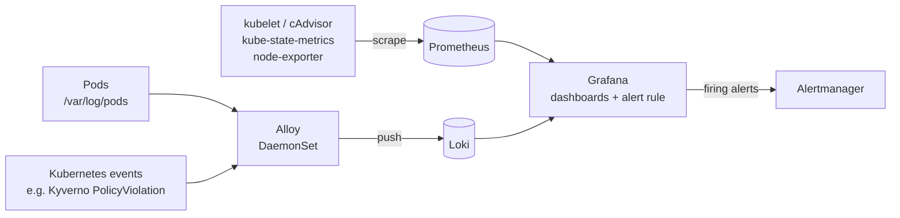
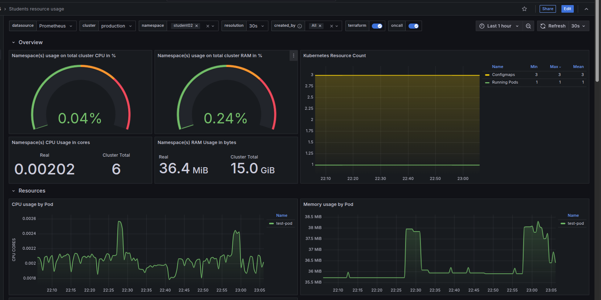
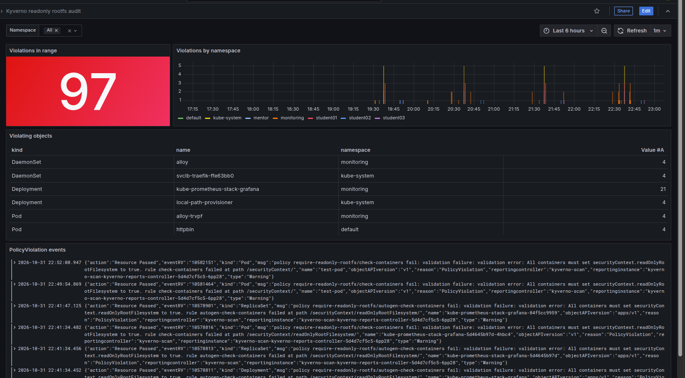
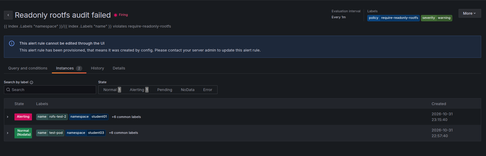

# Task description

## Module 05 – Observability & Troubleshooting

1. Додати в кластер моніторинг систему (на ваш вибір).

2. Створити дашборд для відстеження навантаження на ноди по студентським неймспейсам.

3. Створити дашборд і алярм при знаходженні в логах поди сповіщення про не проходження аудиту по readonly root filesystem.

---

# Realisation

The cluster is the same single-node k3s cluster as in [Module 04](../module04/README.md).
Everything is deployed with the Flux GitOps setup from [Module 03](../module03/README.md):
the manifests are added to `main`, the GitHub Actions workflow renders them into a PR
to the `production` branch, and Flux applies them after the merge.

The monitoring system has two parts, both in the `monitoring` namespace:

- **Metrics:** `kube-prometheus-stack` (Prometheus, Alertmanager, Grafana,
  kube-state-metrics, node-exporter).
- **Logs:** Loki stores logs, Alloy collects pod logs and Kubernetes events and
  sends them to Loki.

Grafana shows both, and also evaluates the alert rule for task 3.



## Repository layout

```
clusters/production/
└── monitoring.yaml                       # Flux Kustomizations: monitoring-controllers -> monitoring-configs
monitoring/
├── base/
│   ├── controllers/
│   │   ├── kube-prometheus-stack/
│   │   │   ├── namespace.yaml                    # monitoring namespace
│   │   │   ├── helmrepo.yaml                     # HelmRepository prometheus-community
│   │   │   ├── helmrelease.yaml                  # HelmRelease kube-prometheus-stack 67.x
│   │   │   ├── kube-state-metrics-config.yaml    # extra kube-state-metrics values (ConfigMap)
│   │   │   ├── kustomizeconfig.yaml              # lets kustomize rename the values ConfigMap
│   │   │   └── kustomization.yaml
│   │   └── loki-stack/
│   │       ├── helmrepo.yaml                     # HelmRepository grafana
│   │       ├── loki-helmrelease.yaml             # HelmRelease loki 7.5.0
│   │       ├── alloy-helmrelease.yaml            # HelmRelease alloy 1.15.0
│   │       └── kustomization.yaml
│   └── configs/
│       ├── dashboards/                           # Grafana dashboards (ConfigMap, grafana_dashboard: "1")
│       │   ├── fwdays-module05-student-namespaces.json
│       │   ├── readonly-rootfs.json
│       │   └── kustomization.yaml
│       └── alerts/                               # Grafana alert rule (ConfigMap, grafana_alert: "1")
│           ├── readonly-rootfs.yaml
│           └── kustomization.yaml
└── production/                                   # production overlays
    ├── controllers/{kube-prometheus-stack,loki-stack}/kustomization.yaml
    └── configs/{dashboards,alerts}/kustomization.yaml
```

### Flux

[`clusters/production/monitoring.yaml`](../../clusters/production/monitoring.yaml)
adds two Flux `Kustomization`s that read from the `rendered-production` source:

| Kustomization | Path | Contents |
|---|---|---|
| `monitoring-controllers` | `./monitoring/controllers` | `kube-prometheus-stack` and `loki-stack`. `wait: true`, so Flux waits until the HelmReleases are ready. |
| `monitoring-configs` | `./monitoring/configs` | Dashboards and alert rules. `dependsOn: monitoring-controllers`, so Grafana and its sidecars already exist. |

The [render workflow](../../.github/workflows/render-manifests.yaml) now also runs on
changes in `monitoring/**`. It builds every folder in `monitoring/production/controllers/`
and `monitoring/production/configs/` into `monitoring/controllers/<name>.yaml` and
`monitoring/configs/<name>.yaml` on the `production` branch.

Check the state:

```
flux get kustomizations monitoring-controllers monitoring-configs
flux get helmreleases -n monitoring
kubectl -n monitoring get pods
```

## 1. Monitoring system

### Metrics: kube-prometheus-stack

[`helmrelease.yaml`](../../monitoring/base/controllers/kube-prometheus-stack/helmrelease.yaml)
installs chart `kube-prometheus-stack` `67.x` from
`https://prometheus-community.github.io/helm-charts`. `crds: CreateReplace` lets Flux
install and upgrade the Prometheus Operator CRDs.

Main values:

```yaml
grafana:
  enabled: true
  defaultDashboardsEnabled: false     # only our own dashboards, from git
  persistence:
    enabled: true
    size: 5Gi
  additionalDataSources:
    - name: Loki
      uid: loki                       # fixed uid, used by the dashboard and the alert rule
      type: loki
      url: http://loki.monitoring.svc:3100
      access: proxy
  sidecar:
    alerts:                           # load alert rules from ConfigMaps labeled grafana_alert: "1"
      enabled: true
      label: grafana_alert
      labelValue: "1"
    dashboards:                       # put dashboards into the folder from the grafana_folder annotation
      folderAnnotation: grafana_folder
      provider:
        foldersFromFilesStructure: true
prometheus:
  prometheusSpec:
    retention: 10d
    scrapeClasses:                    # add cluster="production" to every scraped series
      - name: default
        default: true
        relabelings:
          - targetLabel: cluster
            replacement: production
    storageSpec:                      # 10Gi PVC
alertmanager:
  enabled: true
```

- `scrapeClasses`: the default scrape class applies to every ServiceMonitor and
  PodMonitor. It adds the `cluster` label, which the dashboards filter on.
  Prometheus doesn't add this label by itself, and `externalLabels` are not visible
  in Grafana queries.
- `prometheusSpec.securityContext` runs Prometheus as UID `65534`, so it can write
  to the k3s `local-path` volume.

Extra kube-state-metrics values come from
[`kube-state-metrics-config.yaml`](../../monitoring/base/controllers/kube-prometheus-stack/kube-state-metrics-config.yaml),
which kustomize turns into a ConfigMap referenced by `valuesFrom`:

- `metricLabelsAllowlist`: exports the `person` pod label and all namespace labels,
  e.g. `kube_pod_labels{label_person="student"}`.
- `customResourceState` and `rbac.extraRules`: `gotk_resource_info` metrics with the
  state of Flux objects (Kustomizations, HelmReleases, sources).

The `monitoring` namespace has `pod-security.kubernetes.io/enforce: privileged`,
because node-exporter and Alloy need host access.

### Logs: loki-stack

[`loki-stack`](../../monitoring/base/controllers/loki-stack) contains the `grafana`
`HelmRepository` (`https://grafana.github.io/helm-charts`) and two HelmReleases:

| HelmRelease | Chart | Purpose |
|---|---|---|
| [`loki`](../../monitoring/base/controllers/loki-stack/loki-helmrelease.yaml) | `loki` `7.5.0` (Loki 3.6) | Log storage |
| [`alloy`](../../monitoring/base/controllers/loki-stack/alloy-helmrelease.yaml) | `alloy` `1.15.0` | Log collector, `dependsOn: loki` |

Loki runs in `SingleBinary` mode with one replica and filesystem storage on a 10Gi
PVC, which is enough for a single-node cluster. Logs are kept for 7 days
(`retention_period: 168h`, compactor retention enabled). The gateway, caches,
canary and the scalable `read`/`write`/`backend` targets are disabled.

Alloy runs as a DaemonSet and mounts `/var/log` from the node. Its pipeline:

| Component | What it does |
|---|---|
| `discovery.kubernetes "pods"` + `discovery.relabel "pods"` | Finds pods and sets the labels `namespace`, `pod`, `container`, `app` and the log file path `/var/log/pods/*<uid>/<container>/*.log` |
| `loki.source.file "pods"` + `loki.process "pods"` | Reads the log files and parses the containerd (CRI) format |
| `loki.source.kubernetes_events "events"` | Reads Kubernetes events as JSON with `job="kubernetes-events"` |
| `loki.write "default"` | Pushes everything to `http://loki.monitoring.svc:3100/loki/api/v1/push` |

Check that logs arrive:

```
kubectl -n monitoring port-forward svc/loki 3100:3100
curl -s localhost:3100/loki/api/v1/labels
```

### Grafana

Grafana is available inside the cluster as `svc/kube-prometheus-stack-grafana`:

```
kubectl -n monitoring port-forward svc/kube-prometheus-stack-grafana 3000:80
```

Open http://localhost:3000 and log in as `admin`. The password is `adminPassword`
in the HelmRelease; change it or move it to a Secret for real use.

### Dashboards and alerts from git

Dashboards and alert rules are not created in the UI. They are ConfigMaps in
`monitoring/base/configs`, and the Grafana sidecars load them:

| Folder | ConfigMap | Label | Loaded by |
|---|---|---|---|
| [`dashboards`](../../monitoring/base/configs/dashboards) | `flux-grafana-dashboards` | `grafana_dashboard: "1"` | dashboards sidecar |
| [`alerts`](../../monitoring/base/configs/alerts) | `flux-grafana-alerts` | `grafana_alert: "1"` | alerts sidecar |

The dashboards ConfigMap has the annotation `grafana_folder: module05`, so both
dashboards are in the **module05** folder in Grafana, next to the alert rule.
Both ConfigMaps have `kustomize.toolkit.fluxcd.io/substitute: disabled`, so Flux
doesn't touch `${...}` variables in the dashboards.

Provisioned dashboards are read-only in the UI. To change one, edit the JSON in git.

## 2. Dashboard: student namespaces load on nodes

Dashboard **Students resource usage**
([`fwdays-module05-student-namespaces.json`](../../monitoring/base/configs/dashboards/fwdays-module05-student-namespaces.json),
uid `fwdays_module05_student_namespaces`, tags `Kubernetes`, `Prometheus`, `module05`).

Variables:

| Variable | Query | Purpose |
|---|---|---|
| `datasource` | Prometheus datasources | |
| `cluster` | `label_values(kube_node_info, cluster)` | Comes from the default scrape class |
| `namespace` | `label_values(kube_pod_info{cluster="$cluster", namespace=~"student.*"}, namespace)` | Only student namespaces, multi-select with *All* |
| `created_by` | `label_values(kube_pod_info{namespace=~"$namespace", cluster="$cluster"}, created_by_name)` | Filter pods by owner (Deployment/ReplicaSet, etc.) |
| `resolution` | `1s` … `5m` | Query step |

Rows and panels:

| Row | Panels |
|---|---|
| **Overview** | Share of the node CPU and RAM used by the selected namespaces, in % (`container_cpu_usage_seconds_total / machine_cpu_cores`, `container_memory_working_set_bytes / machine_memory_bytes`); CPU in cores and RAM in bytes; number of pods |
| **Resources** | CPU, memory and CPU throttling by pod |
| **Kubernetes** | QoS classes, pod status reasons, OOM events, container restarts, ready pods, containers per pod, available/unavailable replicas, pods not in `Running`/`Succeeded`, images in use |
| **Kubernetes Storage** | PVC usage in % and bytes, inodes |
| **Network** | Bandwidth, packets, dropped packets and errors by pod |

The overview gauges answer the task directly: how much of the node's CPU and memory
the student namespaces use. The other rows show which pod causes the load.

<!-- TODO: add docs/module05/pictures/scr01.bmp and replace the placeholder below with:  -->
> 📷 **Screenshot 01** (`pictures/scr01.bmp`): the **Students resource usage** dashboard with the student namespaces selected (Overview row with CPU/RAM gauges).

## 3. Dashboard and alert: readonly root filesystem audit

### Where the audit result is

The `require-readonly-rootfs` policy from Module 02/03 runs in `Audit` mode
(`failureAction: Audit`, `background: true` in
[`policies/base/kyverno-policies/helmrelease.yaml`](../../policies/base/kyverno-policies/helmrelease.yaml)),
so Kyverno doesn't block a pod without `readOnlyRootFilesystem: true`. The pod's own
logs don't say anything about it. Instead, Kyverno creates a **Kubernetes event**:

- `type: Warning`, `reason: PolicyViolation`
- on the violating object (Pod, or Deployment/ReplicaSet through the `autogen-` rules)
  and also on the `ClusterPolicy`
- message like `policy require-readonly-rootfs/<rule> fail: ...`

```
kubectl get events -A --field-selector reason=PolicyViolation | grep require-readonly-rootfs
```

Alloy sends these events to Loki (`job="kubernetes-events"`), so they can be found
with LogQL:

```logql
{job="kubernetes-events"} | json | reason="PolicyViolation" | kind!="ClusterPolicy" | msg=~".*require-readonly-rootfs.*"
```

`kind!="ClusterPolicy"` drops the duplicate event on the policy itself.

### Dashboard

Dashboard **Kyverno readonly rootfs audit**
([`readonly-rootfs.json`](../../monitoring/base/configs/dashboards/readonly-rootfs.json),
uid `kyverno-readonly-rootfs`, tags `kyverno`, `module05`), Loki datasource, with a
`namespace` variable:

| Panel | Query |
|---|---|
| Violations in range (stat, red when > 0) | `sum(count_over_time(<query> [$__range]))` |
| Violations by namespace (bars) | `sum by (namespace) (count_over_time(<query> [$__interval]))` |
| Violating objects (table) | `sum by (namespace, kind, name) (count_over_time(<query> [$__range]))` |
| PolicyViolation events (logs) | `<query>` |

<!-- TODO: add docs/module05/pictures/scr02.bmp and replace the placeholder below with:  -->
> 📷 **Screenshot 02** (`pictures/scr02.bmp`): the **Kyverno readonly rootfs audit** dashboard showing the `rofs-test` pod violation.

### Alert

[`alerts/readonly-rootfs.yaml`](../../monitoring/base/configs/alerts/readonly-rootfs.yaml)
is a Grafana alerting provisioning file. It is a **Grafana-managed** alert: Grafana
runs the LogQL query against Loki. A `PrometheusRule` can't be used here because
Prometheus can't query Loki.

Rule `Readonly rootfs audit failed` (folder `module05`, group `kyverno`):

| Setting | Value |
|---|---|
| Query (A) | `sum by (namespace, name) (count_over_time(<query> [5m]))` |
| Condition | Reduce `last` (B) → Threshold `> 0` (C) |
| Evaluation | every `1m`, pending period `0s` |
| No data | `OK`: no violations means no data, which is not an error |
| Labels | `severity: warning`, `policy: require-readonly-rootfs` |
| Summary | `<namespace>/<name> violates require-readonly-rootfs` |

Because of `by (namespace, name)`, every violating object is a separate alert instance.

<!-- TODO: add docs/module05/pictures/scr03.bmp and replace the placeholder below with:  -->
> 📷 **Screenshot 03** (`pictures/scr03.bmp`): Grafana → Alerting → Alert rules, rule **Readonly rootfs audit failed** in the **Firing** state.

The annotations use `{{ index .Labels "namespace" }}` and not `{{ $labels.namespace }}`:
Grafana replaces `$VAR` in provisioning files with environment variables.

The rule sends notifications to the contact point `alertmanager`, which points to the
Alertmanager from kube-prometheus-stack
(`http://kube-prometheus-stack-alertmanager.monitoring.svc:9093`). Firing alerts are
visible in the Alertmanager UI. To deliver them to Slack, Telegram or e-mail, add a
receiver to `alertmanager.config` in the kube-prometheus-stack HelmRelease.

### Test

Create a pod without `readOnlyRootFilesystem` in a student namespace:

```
kubectl -n student01 run rofs-test --image=nginx
kubectl get events -n student01 --field-selector reason=PolicyViolation
```

Within 1–2 minutes:

- the dashboard shows the pod in **Violating objects** and in the logs panel;
- the rule `Readonly rootfs audit failed` is **Firing** in Grafana → Alerting → Alert rules;
- the alert is in Alertmanager:

```
kubectl -n monitoring port-forward svc/kube-prometheus-stack-alertmanager 9093:9093
```

Delete the test pod:

```
kubectl -n student01 delete pod rofs-test
```

After 5 minutes without new events the alert resolves.
